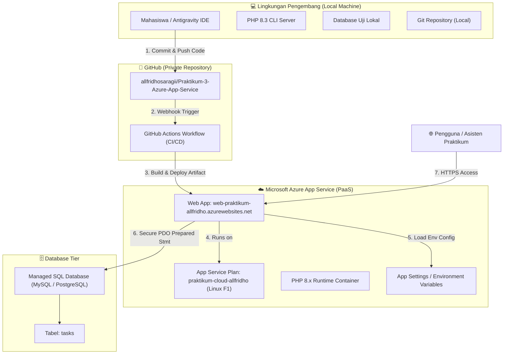

# ARSITEKTUR SISTEM & DESAIN TEKNIS (SYSTEM ARCHITECTURE)
## Student Task Manager — Azure App Service Edition (PHP Native)

- **Mahasiswa**: Allfridho Prima Anjaynata Saragi (NIM: 102062400045)
- **Mata Kuliah**: Komputasi Awan (Praktikum 3)
- **Tanggal Desain**: 26 Oktober 2026

---

## 1. Diagram Arsitektur Cloud (End-to-End Flow)



---

## 2. Struktur Modul Aplikasi PHP Native

Aplikasi dirancang menggunakan pola modular PHP native yang bersih, cepat dieksekusi, dan tidak membebani limitasi CPU Free F1:

- **`index.php`**: Berada tepat di root repositori. Bertindak sebagai halaman utama (Dashboard), menampilkan ringkasan statistik tugas (Total, Pending, In Progress, Completed), filter prioritas/status, pencarian, dan tabel data tugas (**READ**).
- **`create.php`**: Memproses form penambahan tugas baru (**CREATE**). Menyediakan validasi server-side lengkap, sanitasi input, token CSRF, dan eksekusi query parameterized.
- **`edit.php`**: Mengambil data tugas berdasarkan ID, menampilkan formulir perubahan, dan memperbarui data di database (**UPDATE**).
- **`delete.php`**: Menerima request penghapusan berbasis **POST** (metode GET ditolak demi keamanan), memvalidasi ID dan CSRF, lalu menghapus baris data (**DELETE**).
- **`config/database.php`**: Lapisan abstraksi koneksi PDO. Mendukung pemuatan konfigurasi dinamis melalui variabel lingkungan Azure (`DB_HOST`, `DB_PORT`, `DB_NAME`, `DB_USER`, `DB_PASSWORD`, `DB_SSL`, `DB_DRIVER`). Memiliki fallback konfigurasi lokal yang aman.
- **`config/app.php`**: Konfigurasi umum aplikasi (nama aplikasi, base URL, timezone Asia/Jakarta).
- **`includes/functions.php`**: Kumpulan fungsi utilitas:
  - `sanitize($data)`: Pembersihan whitespace.
  - `e($string)`: Shortcut `htmlspecialchars($string, ENT_QUOTES, 'UTF-8')` pencegah Stored/Reflected XSS.
  - `generate_csrf_token()` & `verify_csrf_token($token)`: Proteksi CSRF.
  - `format_date($date)`: Format tanggal akademik Indonesia.
  - `badge_priority($priority)` & `badge_status($status)`: Komponen badge UI responsif.
- **`includes/header.php` & `includes/footer.php`**: Template parsial untuk konsistensi UI, navigasi, dan aset CSS/JS.

---

## 3. Perancangan Skema Database (`database/schema.sql`)

Tabel utama `tasks` dirancang untuk kompatibilitas SQL universal:

```sql
CREATE TABLE IF NOT EXISTS tasks (
    id INT AUTO_INCREMENT PRIMARY KEY,
    title VARCHAR(255) NOT NULL,
    description TEXT,
    course VARCHAR(150) NOT NULL,
    deadline DATE NOT NULL,
    priority VARCHAR(20) NOT NULL DEFAULT 'medium',
    status VARCHAR(20) NOT NULL DEFAULT 'pending',
    created_at TIMESTAMP DEFAULT CURRENT_TIMESTAMP,
    updated_at TIMESTAMP DEFAULT CURRENT_TIMESTAMP ON UPDATE CURRENT_TIMESTAMP,
    INDEX idx_tasks_status (status),
    INDEX idx_tasks_priority (priority),
    INDEX idx_tasks_deadline (deadline)
) ENGINE=InnoDB DEFAULT CHARSET=utf8mb4 COLLATE=utf8mb4_unicode_ci;
```

---

## 4. Desain Keamanan Aplikasi (Defense in Depth)

1. **Anti SQL Injection**: Seluruh query SQL mutasi dan seleksi WAJIB menggunakan PDO Prepared Statements dengan parameter binding (`:param` atau positional `?`).
2. **Anti Cross-Site Scripting (XSS)**: Seluruh output yang berasal dari input pengguna disanitasi menggunakan `htmlspecialchars(..., ENT_QUOTES, 'UTF-8')`.
3. **Anti Cross-Site Request Forgery (CSRF)**: Setiap form mutasi (Create, Update, Delete) menyertakan `csrf_token` kriptografis satu sesi (`random_bytes(32)`).
4. **Proteksi Request Mutasi**: Operasi Delete DILARANG menggunakan metode HTTP GET. Request GET ke `delete.php` otomatis ditolak dengan pesan peringatan keamanan.
5. **Manajemen Kredensial**: Tidak ada kredensial database yang di-hardcode dalam repositori. Berkas `.env` asli masuk ke `.gitignore`. Variabel sensitif diinjeksi via Azure App Service Environment Variables.
6. **Error Suppression di Produksi**: Kesalahan fatal database tidak membocorkan stack trace atau connection string ke pengguna; hanya menampilkan pesan umum yang aman, sementara error log dicatat di internal system.

---

## 5. Pipeline CI/CD GitHub Actions ke Azure App Service

Workflow didefinisikan pada `.github/workflows/azure-webapps-php.yml`:
1. **Trigger**: Push ke branch `main`.
2. **Build Phase**: Checkout kode, validasi sintaks PHP (`php -l`), penyiapan artefak bersih.
3. **Deploy Phase**: Menggunakan action resmi `azure/webapps-deploy@v3` dengan otentikasi Publish Profile atau OpenID Connect (OIDC) yang dikonfigurasikan di Azure Deployment Center.
4. **Verifikasi**: Memeriksa HTTP status 200 pada domain `https://web-praktikum-allfridho.azurewebsites.net`.
