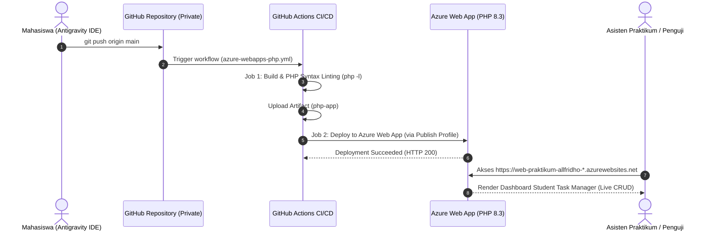

# DOKUMENTASI KONFIGURASI AZURE APP SERVICE (AZURE DEPLOYMENT)
## Praktikum 3 Komputasi Awan — Allfridho Prima Anjaynata Saragi (102062400045)

---

## 1. Spesifikasi Infrastruktur Cloud yang Dibangun

Sesuai petunjuk resmi Modul Praktikum 3 (Halaman 6–13), infrastruktur cloud yang dibangun pada Microsoft Azure terdiri dari komponen-komponen berikut:

### 1.1 App Service Plan
- **Nama Plan**: `praktikum-cloud-allfridho`
- **Resource Group**: `PraktikumServicePlan`
- **Subscription**: `Azure for Students`
- **Sistem Operasi**: `Linux`
- **Region**: `Indonesia Central`
- **Pricing Tier**: `Free F1 (Shared Infrastructure)`
- **Kapasitas**: 1 GB Memory, 60 menit waktu CPU harian (cukup untuk pengujian praktikum, estimasi biaya $0.00).

### 1.2 Web App (App Service)
- **Nama Web App**: `web-praktikum-allfridho`
- **Resource Group**: `AppPraktikum`
- **Publish**: `Code`
- **Runtime Stack**: `PHP 8.3` (Linux container managed)
- **Region**: `Indonesia Central`
- **Linux Plan Terkait**: `praktikum-cloud-allfridho` (F1)
- **Default Domain**: `https://web-praktikum-allfridho-exawahb3gtg4buhq.indonesiacentral-01.azurewebsites.net`
- **Status Operasional**: **Running** (Terverifikasi aktif via HTTP 200).

---

## 2. Alur Integrasi Deployment Center & CI/CD

1. **Source Code Version Control**: Tersimpan di repositori privat `allfridhosaragii/Praktikum-3-Azure-App-Service`.
2. **Build Stage**: Melakukan validasi linting sintaksis PHP seluruh modul (`index.php`, `create.php`, `edit.php`, `delete.php`, dsb.) untuk memastikan zero-error sebelum dilepas ke cloud.
3. **Deploy Stage**: Mempublikasikan artefak aplikasi ke root deployment Linux Azure App Service.
4. **Zero Downtime**: Layanan dikelola penuh oleh platform Azure tanpa intervensi manual SSH atau patching kernel OS.
